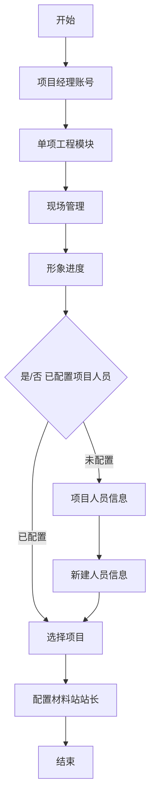
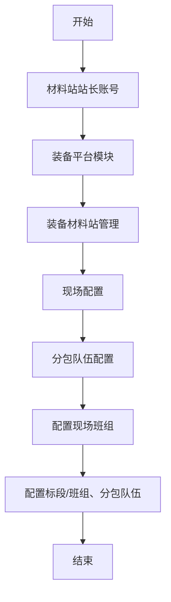
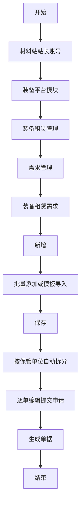
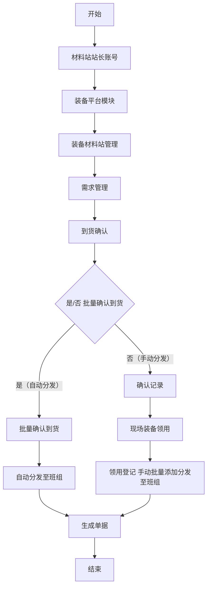
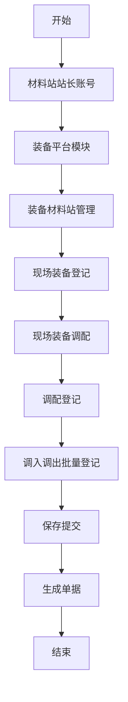
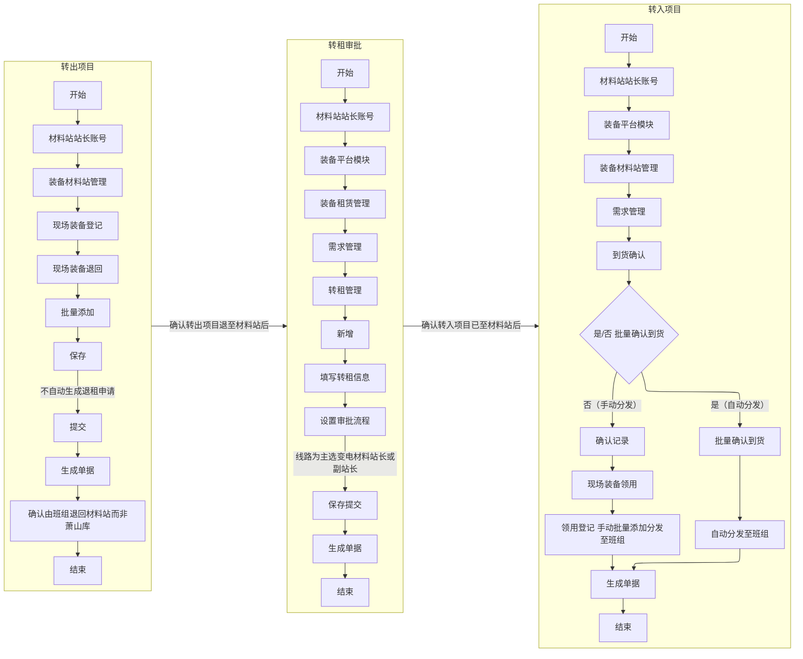
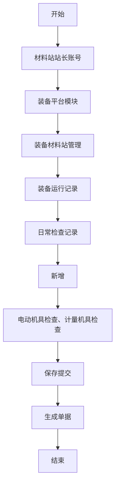
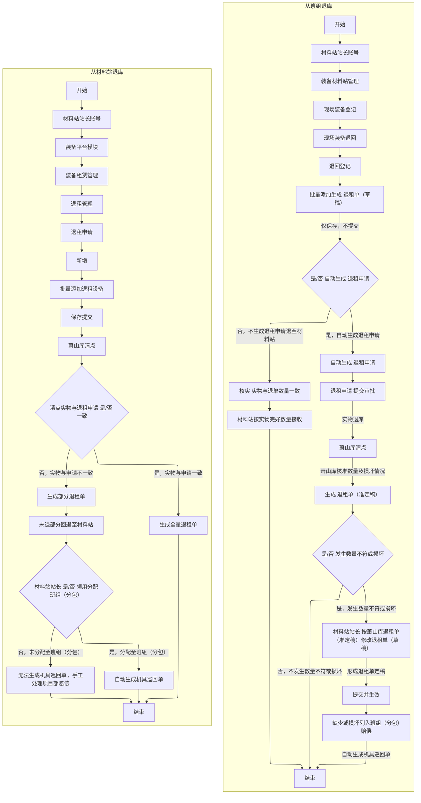

# 单项工程现场装备全流程管理流程图

## 目录

- [1. 项目材料站信息维护](#1-项目材料站信息维护)
- [2. 项目现场管理](#2-项目现场管理)
    - [2.1 项目标段班组和分包队伍配置](#21-项目标段班组和分包队伍配置)
    - [2.2 装备租赁](#22-装备租赁)
        - [2.2.1 租赁申请](#221-租赁申请)
        - [2.2.2 项目领用分配](#222-项目领用分配)
    - [2.3 装备同项目不同标段的调配](#23-装备同项目不同标段的调配)
    - [2.4 装备不同项目之间的转租](#24-装备不同项目之间的转租)
    - [2.5 项目装备日常检查及运维](#25-项目装备日常检查及运维)
    - [2.6 装备退租](#26-装备退租)

---

## [1. 项目材料站信息维护](#目录)

> [!note]
> **项目经理账号操作，配置材料站站长**

> [!important]
>
> #### 1. 线路配套工程以线路为主项目设置变电人员为材料站副站长；
>
> #### 2. 输变电工程以线路为主的项目，同 [1](#1-线路配套工程以线路为主项目设置变电人员为材料站副站长) 策略配置；

---

## [2. 项目现场管理](#目录)

> [!note]
>
> #### 材料站站长账号操作，[未配置的点击跳转到材料站站长配置](#1-项目材料站信息维护)

### [2.1. 项目标段班组和分包队伍配置](#目录)

> [!important]
>
> #### 1. 一个项目含一个主体工程和多个配套工程的，建议标段按"变电站"命名，班组按"分包单位"及“分包队伍”命名，如土建劳务1、2……，电气劳务1、2……，防止混搭难以区分，自有队伍也可按电气1、2……命名；
>
> #### 2. 一个项目含多个主体工程和配套工程的，建议同1策略配置；
>
> #### 3. 此项配置是系统自动生成结算的基础信息，务必优先配置正确，否则影响后续操作；

---

### [2.2. 装备租赁](#目录)

#### [2.2.1 租赁申请](#目录)

---

#### [2.2.2 项目领用分配](#目录)

> [!important]
>
> #### 1. 租赁的工器具及时领用并批量确认到货自动一键分发至班组，省时省力，而且不会出错；
>
> #### 2. 如果特殊情况，无分包班组，也要建立自己的虚拟土建或电气班组，工器具分发至班组，后期可通过 [装备同项目不同标段的调配](#23-装备同项目不同标段的调配) 操作，调入到分包班组。防止工器具遗留在材料站，要多做一项工作，材料站日常盘库等管理；
>
> #### 3. 重点关注一个项目内有多个标段，不同标段可能还是不同分包，更要及时批量确认到货一键分发或领用登记手动批量添加分发至班组，因为一个项目只有一个材料站，生成的租赁数据和相关考核结算只能由标段班组来区分；
>
> #### 4. 线路和变电同用一个系统，变电没有材料站概念，材料站的功能被拆分到萧山库和项目部及班组上，批量确认到货自动一键分发至班组也是妥协的结果，变相的无须去处理材料站的操作，是专门给变电管理模式优化设计开发的；

---

### [2.3. 装备同项目不同标段的调配](#目录)

---

### [2.4. 装备不同项目之间的转租](#目录)

> [!important]
>
> #### 1. 转出项目工器具必须先由班组退至材料站，注意不要使用一键带出自动生成退租申请，使用手工操作退至材料站；
>
> #### 2. 跨项目转租，双方项目材料站站长都要审批通过；
>
> #### 3. 转入项目材料站站长及时分发至班组，操作参考 [项目领用分配](#222-项目领用分配)；

---

### [2.5. 项目装备日常检查及运维](#目录)

---

### [2.6. 装备退租](#目录)

> [!important]
>
> #### 1. 强烈建议从班组退库，生成的退租单（草稿）“只保存，不提交”。系统自动带出“退租申请”后，核对信息后“退租申请”提交审批。萧山库清点装备后，提交退租单（准定稿），退租单（准定稿）= 退租单（草稿）流程结束，退租单（准定稿）≠ 退租单（草稿）材料站站长核实修改退租单形成“新退租单（定稿）”，提交并生效直接分配到班组（分包）自动生成机具巡回单。
>
> #### 2. 班组退库到材料站，材料站应核实退材料站“完好数量”，防止班组（分包）不认数量，影响机具巡回单的生成。
>
> #### 3. 从材料站退库，需注意⚠️退库申请和“实际完好数量一致”，避免萧山库清点退库与申请数量不一致，导致有设备退库不成功，仍然留在材料站，此时，材料站站长必须再次操作[项目领用分配](#222-项目领用分配)，重新分配至班组（分包）生成机具巡回单的，避免影响结算，被考核。如需项目部赔偿，需要手工处理。
